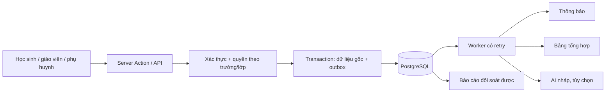

# Đặc tả thực thi theo phase cho LMS K12

**Ngày lập:** 26/09/2026
**Nguồn quyết định:** [roadmap tổng thể](KE_HOACH_KIEM_TRA_VA_NANG_CAP_LMS_K12.md), [định hướng sản phẩm](XAC_NHAN_THAY_DOI_DINH_HUONG_SAN_PHAM_LMS_K12.docx), [schema snapshot](DB_SCHEMA_SNAPSHOT_2026-09-24.md).
**Phạm vi:** một trường THCS thí điểm, khối 6–9; thiết kế dữ liệu hỗ trợ khối 1–12 và chuẩn bị cách ly nhiều trường. LMS phục vụ học sau giờ lên lớp, giao/nộp bài, kiểm tra, phản hồi và phối hợp gia đình. Điểm là đánh giá nội bộ, không phải học bạ chính thức.

Đây là **đặc tả công việc phải thực hiện**, không phải xác nhận các tính năng đã chạy trên production. Không chạy bất kỳ SQL bên dưới trên database thật trước khi hoàn tất Phase 0. Tên migration là tên dự kiến; chỉ chốt khi đối chiếu lịch sử migration và schema thực tế.

## 1. Nguyên tắc kiến trúc và thứ tự phụ thuộc

1. **Dữ liệu gốc trước, dashboard sau.** Bản ghi bài giao, bài nộp, điểm, điểm danh và quan hệ giám hộ là nguồn chuẩn. Báo cáo và AI chỉ đọc hoặc suy ra từ dữ liệu đã chốt.
2. **Ghi một lần, xử lý sau có thể lặp.** Thao tác nghiệp vụ quan trọng được xác thực, kiểm quyền, validate và ghi trong một transaction. Thông báo, tổng hợp và AI nhận việc qua outbox/job; retry không được tạo kết quả trùng.
3. **Không tin client về danh tính hoặc thời gian.** Server suy ra `user_id`, `school_id` và quyền từ session/database; deadline, thời điểm nộp và thứ tự phiên bản dùng đồng hồ database/server.
4. **Mọi dữ liệu có chủ sở hữu.** Bảng nghiệp vụ mang `school_id` hoặc có đường FK bắt buộc, không mơ hồ, tới trường. Quan hệ chéo trường bị chặn bằng FK tổng hợp, RLS và guard ở server.
5. **Migration tương thích ngược.** Thêm cấu trúc → điền dữ liệu → đối soát → chuyển đọc → chuyển ghi → bỏ trường cũ ở đợt sau. Không sửa đè lịch sử học tập để làm dữ liệu cũ “khớp”.
6. **AI có thể tắt.** Không dùng AI làm điều kiện để học sinh xem bài, nộp bài hoặc giáo viên chấm. AI không tự quyết định điểm, gian lận, hạnh kiểm hay kỷ luật.



**Điểm sửa so với roadmap tổng thể:** Phase 1 tạo `schools` và phạm vi trường tối thiểu để guard đa trường hoạt động; Phase 2 mới hoàn thiện năm học, môn, lớp và vai trò. Chỉ kiểm thử “không đọc chéo trường” sau khi dữ liệu đã có `school_id`; trước đó phải chặn action không xác định được phạm vi.

## 2. Việc chủ dự án và trường thí điểm cần chuẩn bị

| Trước phase | Cần cung cấp hoặc xác nhận | Đầu ra bắt buộc |
|---|---|---|
| 0 | Người sở hữu database; môi trường staging; quyền đọc schema/log; chính sách backup hiện có; danh sách thay đổi Git cần giữ | Biên bản hiện trạng và bản sao dữ liệu đã ẩn danh |
| 0–2 | Tên/mã trường, năm học, học kỳ, danh sách khối 6–9, môn, lớp chủ nhiệm, giáo viên và phân công | File danh mục chuẩn có người phụ trách ký duyệt |
| 2–3 | File Excel mẫu thực tế, quy tắc mã học sinh/mã phụ huynh, cách xử lý hồ sơ trùng và chuyển lớp | Mẫu import được duyệt, tối thiểu 30 dòng gồm trường hợp lỗi |
| 3 | Người được quyền cấp/reset tài khoản, cách bàn giao mật khẩu tạm và mã kích hoạt cho từng người | Quy trình bàn giao và thu hồi quyền |
| 4–5 | Cách chấm/rubric nội bộ, hạn nộp, cho nộp lại, quy tắc công bố điểm, tính chuyên cần và quy trình xin nghỉ | Bộ tình huống nghiệp vụ và kết quả mong đợi |
| 6 | Các tác vụ AI được phép, dữ liệu nào có thể gửi, người duyệt và ngân sách/quota | Quy tắc AI và cờ bật/tắt theo trường |
| 7–8 | Một người chịu trách nhiệm UAT; giáo viên và phụ huynh thử nghiệm; lịch pilot; kênh xử lý sự cố | Biên bản UAT, kế hoạch go-live và tiêu chí dừng |

Nếu thiếu dữ liệu thật, dùng dữ liệu giả cho phát triển nhưng không kết luận migration hoặc báo cáo đã đúng với production.

## 3. Danh mục SQL/migration dự kiến

Các tệp dưới đây là **đầu ra cần viết sau khi kiểm kê database**, không phải tệp SQL hiện đã tồn tại. Mỗi migration phải có kiểm tra trước/sau, được chạy trên bản sao dữ liệu, và không gọi trực tiếp từ UI.

| Thứ tự | Migration dự kiến | Nội dung SQL chính | Điều kiện trước khi áp dụng |
|---|---|---|---|
| M0 | `202609260000_schema_baseline.sql` | Baseline được sinh và kiểm chứng từ schema đang chạy: bảng, FK, index, RLS, function, trigger, Storage policy | Đối chiếu migration history; chạy sạch trên DB tạm; không ghi đè schema thật |
| M1 | `202609260001_school_scope.sql` | `schools`, `school_memberships` tối thiểu; `school_id` nullable trên bảng lõi; mapping dữ liệu hiện có sang trường pilot; FK/index theo trường | Không còn bản ghi không xác định được chủ sở hữu trước khi ép `NOT NULL` |
| M2 | `202609260002_audit_outbox_idempotency.sql` | `audit_events`, `outbox_events`, `idempotency_keys`; unique event key, trạng thái, retry và index pending | Đã thống nhất loại sự kiện, chính sách lưu và worker |
| M3 | `202609260003_k12_catalog.sql` | `academic_years`, `terms`, `grade_levels`, `subjects`; chuẩn hóa `school_terms`; nới check `homerooms.grade_level` thành 1–12 | Đã đối soát tên học kỳ/khối/môn cũ |
| M4 | `202609260004_k12_rosters.sql` | `homeroom_enrollments`, `homeroom_teacher_assignments`, `role_assignments`; mở rộng `school_memberships` và `class_teacher_assignments`; `classes.subject_id` | Đã xác định một lớp hành chính và một lớp môn là hai thực thể khác nhau |
| M5 | `202609260005_identity_import.sql` | `student_identifiers`, `guardian_identifiers`, `account_activations`, `import_jobs`, `import_rows`; mã định danh unique theo trường, mã kích hoạt lưu dạng hash | Đã duyệt mẫu Excel và quy tắc đối soát |
| M6 | `202609260006_learning_publication.sql` | Phiên bản học liệu, trạng thái công bố, rubric, trạng thái điểm, lịch sử điều chỉnh; sửa `exam_attempts` để `max_attempts` cấu hình được, mặc định 1 | Đã đối chiếu `course_items`, `homework`, `exams`, submission cũ |
| M7 | `202609260007_school_attendance_interventions.sql` | Chính sách chuyên cần theo trường, hồ sơ `intervention_cases` và lịch sử hành động | Trường xác nhận quy tắc chuyên cần và người chịu trách nhiệm hỗ trợ |
| M8 | `202609260008_reporting_projections.sql` | View/RPC tổng hợp theo trường–kỳ–môn; bảng trạng thái projector/checkpoint nếu cần | Định nghĩa báo cáo và dữ liệu gốc đã ổn định |
| M9 | `202609260009_ai_jobs_scope.sql` | Bổ sung `school_id`, quota, trạng thái duyệt, prompt/model/source hash cho `learning_ai_jobs` hiện có | Worker, chính sách dữ liệu và quota được duyệt |

### Quy tắc viết SQL

- Tất cả PK là UUID, FK có kiểu và chính sách xóa rõ; bản ghi học tập dùng `RESTRICT` hoặc soft-close, không cascade xóa điểm/bài nộp.
- Unique key bao gồm `school_id` cho mã học sinh, mã phụ huynh, lớp, môn và năm học. FK tổng hợp `(school_id, foreign_id)` chặn liên kết nhầm trường khi có dữ liệu đa trường.
- Các `CHECK` giới hạn trạng thái hợp lệ; timestamps dùng `timestamptz`, thời điểm ghi do database đặt; các khoảng hiệu lực không được đảo đầu/cuối.
- Thêm index theo truy vấn đã đo, ưu tiên `(school_id, class_id, created_at)` hoặc `(school_id, student_id, term_id)` khi truy vấn thực sự dùng chúng; không tạo index chỉ vì có cột.
- Mỗi bảng mới phải bật RLS, có policy tối thiểu và test cho `anon`, `authenticated`, service role; `SECURITY DEFINER` phải có `search_path` cố định và quyền `EXECUTE` được thu hẹp.
- Backfill chạy theo lô có checkpoint, báo cáo số bản ghi `mapped/unmapped/conflict`; không dùng `DELETE` để xử lý xung đột. Constraint chặt chỉ bật sau khi `unmapped = 0`.
- Ghi lệnh kiểm tra ngược: row count, orphan FK, duplicate key, checksum/tổng điểm và chính sách RLS. Rollback mặc định là khôi phục bản sao hoặc chuyển lại luồng đọc/ghi; không giả định migration phá cấu trúc có thể đảo bằng một lệnh `DOWN`.
- Bốn migration ngày 24/09 phải được kiểm tra lại: `exam_attempts` đang unique theo `(exam_id, student_id)` nên không cho nhiều lượt; SQL video cần kiểm tra duration bằng 0, khoảng xem âm/vượt độ dài; tracking RPC cần kiểm tra thiếu dòng; mọi function được gọi bằng service role cần guard ứng dụng và thử tải.

Các truy vấn đối soát phải được đưa vào script kiểm tra migration, chạy trên staging sau mỗi đợt backfill. Mẫu tối thiểu (tên bảng/cột phải đối chiếu M0 trước khi dùng):

```sql
select count(*) as unmapped_classes from public.classes where school_id is null;
select school_id, student_code, count(*)
from public.student_identifiers
group by school_id, student_code having count(*) > 1;
select count(*) as cross_school_classes
from public.classes c join public.terms t on t.id = c.term_id
join public.academic_years y on y.id = t.academic_year_id
where c.school_id <> y.school_id;
```

Mỗi truy vấn phải trả 0 trước khi bật constraint chặt hoặc chuyển đọc sang mô hình mới. Kiểm tra tương tự cho enrollment, giáo viên, giám hộ, submission và báo cáo.

### Hợp đồng SQL tối thiểu cho luồng dữ liệu ổn định

Các cột bắt buộc của `outbox_events`: `id`, `school_id`, `event_type`, `aggregate_type`, `aggregate_id`, `event_key`, `payload`, `status`, `attempts`, `available_at`, `created_at`, `processed_at`, `last_error_code`. `event_key` unique để retry cùng một thay đổi không phát thông báo hai lần. Worker claim việc bằng khóa hàng (`FOR UPDATE SKIP LOCKED`) và ghi kết quả xử lý; lỗi tạm thời quay lại hàng đợi với backoff, lỗi không thể xử lý chuyển `dead_letter` để vận hành xem lại.

`idempotency_keys` lưu `(school_id, actor_id, operation, request_key)` unique, `request_hash`, `response_ref` và `created_at`. Gửi lại cùng key và cùng payload trả cùng kết quả; cùng key với payload khác trả lỗi xung đột. Hết hạn/lưu trữ key phải dài hơn cửa sổ retry của client. Với dịch vụ ngoài như email, worker lưu `notification_deliveries(event_key, recipient_id, provider_message_id, status)` unique theo event và người nhận, đồng thời truyền idempotency key cho provider nếu được hỗ trợ. Nếu provider không hỗ trợ, hệ thống bảo đảm không tạo hai job nội bộ nhưng vẫn phải theo dõi khả năng gửi lặp khi crash xảy ra sau khi provider nhận yêu cầu.

`audit_events` lưu `school_id`, `actor_id`, `action`, `entity_type/id`, thời gian, request ID và dữ liệu trước/sau được lọc PII. Không ghi mật khẩu, mã kích hoạt, token hoặc toàn bộ bài làm vào log.

## 4. Phase 0 — Baseline và chứng minh có thể tái tạo, tuần 1–2

**Kiểm tra:** chụp trạng thái Git; đối chiếu bốn migration mới với schema thật; kiểm tra database migration history, bảng, FK, trigger, RLS, bucket, số dòng; xác định dữ liệu thật và chính sách backup. `schema.sql` hiện rỗng và nhiều SQL lịch sử đang bị xóa trong working tree, nên tuyệt đối không chạy lại toàn bộ SQL cũ lên production.

**Thay đổi phải làm:** giữ checkpoint Git có thể quay lại; tách file sinh tạm khỏi source; tạo DB staging bằng bản sao đã ẩn danh; viết M0; tạo seed một trường, 2 năm học, khối 6–9, tối thiểu 2 lớp, 3 môn, 2 giáo viên, 10 học sinh và 3 phụ huynh; thêm script `typecheck`, unit/integration/E2E/build. Ghi ADR cho quyền, mô hình lớp, định danh, đánh giá và AI.

**Bằng chứng qua phase:** `supabase db reset` trên DB trống thành công 2 lần liên tiếp; số bảng/function/policy/index so với schema nguồn có bảng sai lệch bằng 0 hoặc từng sai lệch được giải thích; backup khôi phục được; không dùng dữ liệu thật trong seed; TypeScript và build có exit code 0. Lint hiện là baseline khoảng 1.805 lỗi/357 cảnh báo, chưa được coi là đạt.

## 5. Phase 1 — Quyền, ghi dữ liệu và bảo mật, tuần 3–5

**SQL:** M1–M2. Tạo trường pilot, membership tối thiểu nối người dùng với trường, rồi gắn `school_id` vào các bảng lõi; mapping bản ghi cũ theo lớp/khóa/học sinh. Tạo thêm trường thứ hai chỉ trong seed staging để thử cách ly dữ liệu. Tạo outbox, idempotency và audit. Chỉ ép `school_id NOT NULL` từng bảng sau khi backfill hoàn tất. RLS cho browser client không cho truy cập nếu thiếu quyền rõ ràng.

**Source và tính năng:** mở rộng `lib/auth/authorize.ts` thành guard theo trường/lớp/tài nguyên; kiểm từng Server Action và API route dùng `createAdminClient`. Ưu tiên `academic.ts`, admin class/user actions, course builder, schedule, attendance, parent linking và AI. `proxy.ts` chỉ điều hướng. Dời file học liệu/bài nộp sang bucket private, cấp signed URL ngắn hạn qua server. Mọi thao tác ghi nghiệp vụ quan trọng nhận request key, ghi dữ liệu gốc và outbox cùng transaction. Notification/analytics không được làm thất bại một bài nộp đã được chấp nhận; trạng thái hậu xử lý phải hiển thị và retry được.

**Luồng mẫu:** `submit homework` → xác thực học sinh → kiểm trường/lớp/bài công bố/hạn → transaction ghi `homework_submissions` và `outbox_events` → trả submission ID → worker gửi thông báo cho giáo viên và cập nhật chỉ số. Dashboard đọc từ submission, không chờ AI hay email.

**Kiểm thử đo được:** 100% điểm vào dùng service role có guard và test quyền; 0 truy vấn chéo hai trường seed/lớp trả dữ liệu khi thử bằng 4 role; 0 file riêng tư tải được bằng public URL; gửi lặp cùng request key tạo đúng 1 submission và 1 outbox event; lỗi worker không làm mất submission; 100% audit event của các hành động nhạy cảm **đã có trong hệ thống** ghi actor, trường, thời gian và request ID. Các hành động import/reset mới được kiểm ở Phase 3. Trên staging, chạy ít nhất 100 lần retry có chủ đích cho mỗi thao tác ghi quan trọng mà không sinh bản ghi trùng.

## 6. Phase 2 — Mô hình học vụ K12, tuần 6–9

**SQL:** M3–M4. `academic_years` thuộc trường, `terms` thuộc năm học, `grade_levels` là 1–12, `subjects` có mã trong trường. `homerooms` là lớp chủ nhiệm theo năm học; `homeroom_enrollments` giữ `student_id`, `homeroom_id`, `valid_from/to`, trạng thái. `classes` là lớp môn, liên kết môn, kỳ và trường; một lớp môn có nhiều học sinh qua `enrollments`. `class_teacher_assignments` giữ giáo viên bộ môn/trợ giảng, `homeroom_teacher_assignments` giữ giáo viên chủ nhiệm; cả hai có khoảng hiệu lực. Mở rộng membership tối thiểu của Phase 1 và thêm `role_assignments` để một người có nhiều vai trò có scope. Dữ liệu `school_terms` cũ được ánh xạ; tên bảng cũ chưa xóa ở phase này.

**Source và tính năng:** màn admin quản lý năm học, kỳ, khối, môn, lớp chủ nhiệm, lớp môn, phân công và chuyển lớp. `courses` trở lại nghĩa chương trình/học liệu dùng lại, không đóng vai khối học. Chuyển từng luồng đọc/ghi sang ID mới, sau đó ẩn UI tạo “khối” vào `courses`. Học sinh chuyển lớp tạo quan hệ mới và kết thúc quan hệ cũ; lịch sử bài làm giữ nguyên.

**Kiểm thử đo được:** 100% học sinh trong dữ liệu pilot có đúng một lớp chủ nhiệm hiệu lực tại một thời điểm của một năm; một học sinh có thể học ít nhất 3 môn với giáo viên khác nhau; giáo viên môn A không sửa được bài/điểm môn B; chủ nhiệm xem tổng hợp nhưng không sửa điểm môn; chuyển lớp và đổi kỳ giữ nguyên 100% số submission/grade/attendance; số quan hệ chéo trường = 0; backfill có `unmapped = 0` trước khi bật constraint chặt.

## 7. Phase 3 — Tài khoản và import Excel, tuần 10–11

**SQL:** M5. `student_identifiers` có `(school_id, student_code)` unique và trỏ tới user; `guardian_identifiers` tương tự. `account_activations` lưu **hash** của mã một lần, hạn dùng, số lần thử và trạng thái; không lưu mã rõ. `import_jobs` giữ file hash, người chạy, trạng thái, số dòng và kết quả; `import_rows` giữ dòng chuẩn hóa, lỗi và quyết định sửa. Quan hệ giám hộ gắn trường, trạng thái xác minh và lịch sử thu hồi.

**Source và tính năng:** nhập `school_code + student_code + password`, ánh xạ alias nội bộ cho Supabase Auth; học sinh không cần email riêng. Phụ huynh dùng email nếu có, nếu không dùng mã phụ huynh. Một file Excel có thể tạo/cập nhật người dùng, phụ huynh, lớp chủ nhiệm và quan hệ. Server đọc file có giới hạn kích thước/số dòng, normalize mã, kiểm trùng, hiển thị preview, cho sửa dòng lỗi, rồi commit có idempotency. Xuất kết quả theo dòng và audit. Mật khẩu tạm `abc123` chỉ tạo một phiên kích hoạt giới hạn: server kiểm mã kích hoạt riêng, bắt đổi mật khẩu, thu hồi phiên kích hoạt rồi mới cho vào portal; mọi action/API dữ liệu kiểm trạng thái kích hoạt. Reset thu hồi session hiện có và tạo mã mới. Không gửi alias nội bộ hoặc mã kích hoạt vào log.

**Quy tắc lỗi:** không tự ghép hai người chỉ vì trùng tên; mã học sinh trùng cùng trường là xung đột cần đối soát; một phụ huynh có thể có nhiều con; một học sinh có thể có nhiều người giám hộ đã xác minh. Nếu commit một phần vì lỗi hạ tầng, job ghi checkpoint và chạy lại chỉ phần chưa hoàn tất, không tạo tài khoản trùng.

**Kiểm thử đo được:** import lại cùng file 3 lần giữ nguyên số người/lớp/quan hệ; 100% dòng lỗi có mã lỗi và số dòng; file 1.000 dòng hoàn tất preview trong ≤30 giây trên staging mục tiêu; account chưa kích hoạt trả 403 cho mọi endpoint dữ liệu; mã sai/hết hạn/dùng lại đều thất bại; sau reset, session cũ không đọc được dữ liệu và mật khẩu mới bắt buộc thay `abc123`.

## 8. Phase 4 — Học liệu, bài tập và kiểm tra, tuần 12–15

**SQL:** M6. Bản học liệu/đề đã công bố được version hoặc snapshot; bài giao có `draft/published/closed`; điểm có `ungraded/draft/published/locked`; rubric và audit lưu người, thời gian, lý do sửa. `exam_attempts` hiện unique `(exam_id, student_id)` nên migration thay bằng `(exam_id, student_id, attempt_no)` unique; bài mặc định một lượt, giáo viên có thể cấu hình tối đa nhiều lượt. Nội dung câu hỏi/đáp án của mỗi lượt phải bất biến sau khi bắt đầu. Index unique của `exam_submissions(exam_id, student_id)` cũng phải đổi sang unique theo `attempt_id`, sau khi đối soát bài nộp cũ.

**Source và tính năng:** giáo viên tạo/công bố học liệu, bài tập, kiểm tra; học sinh thấy việc cần làm và nộp bài; giáo viên chấm, phản hồi, công bố. Autosave dùng phiên bản tăng dần, từ chối bản nháp cũ ghi đè bản mới. Tệp nộp nằm trong private bucket. Thảo luận theo lớp/bài có quyền ẩn và audit. Thông báo tạo từ outbox sau commit. Trạng thái `score = null` là chưa chấm, khác điểm 0.

**Kiểm thử đo được:** E2E đủ 4 vai trò cho luồng công bố → nộp → chấm → xem kết quả; 100 lần gửi lặp một bài tạo đúng số lượt theo chính sách; 0 trường hợp draft cũ ghi đè draft mới; thay đề sau khi có lượt làm không đổi snapshot; học sinh/phụ huynh không thấy điểm trước công bố; sửa điểm đã công bố luôn có audit và lý do; thử mất mạng lúc nộp phải hiện trạng thái rõ và không báo thành công giả.

## 9. Phase 5 — Điểm danh, phụ huynh và hỗ trợ sớm, tuần 16–18

**SQL:** M7–M8. Chính sách chuyên cần có hiệu lực theo trường/kỳ, định nghĩa đi muộn và nghỉ có phép. `intervention_cases` gồm trường, học sinh, môn/lớp, bằng chứng, mức ưu tiên, người phụ trách, hạn xem lại, trạng thái; bảng hành động và lịch sử trạng thái không cho sửa đè. View/RPC báo cáo aggregate từ dữ liệu gốc, có lọc trường/kỳ/lớp và pagination; không dựa vào một trang PostgREST mặc định để tính tổng.

**Source và tính năng:** lịch học/buổi/tiết, điểm danh, xin nghỉ–duyệt, phụ huynh xem kết quả đã công bố. Báo cáo giáo viên bộ môn, chủ nhiệm, ban giám hiệu phải cùng định nghĩa và drill-down về bản ghi nguồn. Telemetry hoạt động, thời gian online và video chỉ là thông tin phụ, không suy ra học sinh đã hiểu bài. Giáo viên duyệt trường hợp hỗ trợ, ghi hành động và lần xem lại.

**Kiểm thử đo được:** cùng dữ liệu nguồn, tổng theo lớp/môn/trường bằng nhau sau mọi bộ lọc; báo cáo 1.500+ bản ghi không bị cắt; 0 điểm danh/job thông báo/điểm thưởng trùng khi lưu lại không đổi; chủ nhiệm chỉ xem đúng lớp, phụ huynh chỉ xem con đã xác minh; mỗi case đóng có người xử lý, bằng chứng và kết quả xem lại; 100% chỉ số báo cáo có định nghĩa mẫu số và khoảng thời gian.

## 10. Phase 6 — AI trong phạm vi có thể kiểm soát, tuần 19–20

**SQL:** M9, mở rộng `learning_ai_jobs` đã có thay vì tạo bảng job thứ hai. Job có `school_id`, loại việc, trạng thái, số lần thử, nguồn dữ liệu, prompt/model version, chi phí ước tính/thực tế, người duyệt và thời điểm. `kind` hiện chỉ cho `individual/class`, vì vậy migration phải mở rộng constraint cho đúng ba tác vụ pilot và backfill giá trị cũ. Kết quả nháp và nội dung được giáo viên sửa/duyệt lưu riêng, tránh AI ghi thẳng vào điểm hoặc thông báo phụ huynh.

**Source và tính năng:** chỉ ba việc pilot: sinh nháp câu hỏi, nháp nhận xét bài kiểm tra và gợi ý hỗ trợ dựa trên bằng chứng đã có. Validate schema đầu ra; từ chối nội dung không đủ nguồn hoặc nhận định chắc chắn về gian lận/hạnh kiểm. Một trường có quota và concurrency giới hạn, timeout/retry có backoff, cờ tắt AI; lỗi AI trả về trạng thái rõ để giáo viên tiếp tục làm thủ công.

**Kiểm thử đo được:** 0 nội dung AI tự gửi cho phụ huynh/học sinh khi chưa duyệt; 0 điểm chính thức do AI tự ghi; 100% kết quả AI có source hash, phiên bản prompt/model và trạng thái duyệt; 100% đầu ra sai schema bị từ chối; mô phỏng lỗi/quota 100 lần không làm hỏng nộp/chấm bài; đo tỷ lệ giáo viên chấp nhận/sửa/bác bỏ, độ trễ p95, số lỗi và chi phí theo trường. Tỷ lệ chấp nhận là chỉ số học hỏi, không phải điều kiện phải cao để pilot thành công.

## 11. Phase 7 — Kiểm thử vận hành và UAT, tuần 21–22

**Thực thi:** full lint 0 error; unit test cho tính điểm, quyền, trạng thái và idempotency; integration test với Supabase cục bộ cho migration/RLS/RPC; Playwright cho các hành trình xuyên vai trò. Dùng dữ liệu staging có quy mô tối thiểu: 1 trường, 4 khối, 20 lớp, 50 học sinh/lớp, 12 môn, 30 giáo viên, 1 năm lịch sử, 100.000 activity events. Đây là dữ liệu sinh giả, không suy ra quy mô trường thật.

**Hiệu năng mục tiêu trên staging tương đương pilot:** p95 mở dashboard học sinh/giáo viên ≤3 giây; p95 mở điểm danh ≤2 giây; p95 lưu 40–50 bản ghi điểm danh ≤3 giây; p95 xác nhận nộp bài ≤3 giây khi 50 học sinh nộp gần đồng thời. Mỗi phép đo ít nhất 100 request sau warm-up, báo cáo p50/p95, lỗi, số query và kích thước payload; nếu staging không tương đương production phải ghi rõ giới hạn.

**Độ tin cậy mục tiêu:** 0 bài nộp được báo thành công nhưng thiếu bản ghi; 0 bài/điểm/điểm danh trùng do retry; đối soát báo cáo với nguồn đạt 100% trên bộ dữ liệu UAT; khi nhà cung cấp thông báo hoạt động bình thường, ≥99% sự kiện được xử lý trong 60 giây; sự kiện lỗi có thể retry và có dead-letter. Backup được khôi phục trên môi trường tạm. Gate go-live: hạ tầng có backup phục hồi theo thời điểm, RPO ≤15 phút và RTO ≤2 giờ đã diễn tập; nếu không đạt, chưa bật bài kiểm tra và nộp bài thật trên production.

**Bảo mật và khả năng dùng:** quét trực tiếp action/API bằng các ID chéo trường/lớp; kiểm tra signed URL hết hạn; kiểm tra logout/đổi tài khoản không xem cache cũ; kiểm tra bàn phím, tương phản, responsive và màn hình đọc theo mục tiêu WCAG 2.2 AA. Tất cả lỗi blocker/critical phải bằng 0; lỗi còn lại có người phụ trách và thời hạn.

## 12. Phase 8 — Pilot THCS, tuần 23–26

Chạy import giả lập → dry-run dữ liệu thật → đối soát từng lớp → bật từng lớp/khối. Mỗi đợt có người duyệt, thời điểm bắt đầu, bản backup, phiên bản code/schema, cách dừng ghi và cách quay lại phiên bản trước. Đào tạo giáo vụ, giáo viên, học sinh và phụ huynh bằng luồng thực tế.

**Theo dõi hàng ngày:** số đăng nhập thành công/thất bại; số bài giao, nộp, chấm; lỗi ghi dữ liệu; outbox tồn; AI job lỗi; report lệch; số sự cố phân quyền; thời gian p95; phản hồi của giáo viên. Tổng hợp theo trường/lớp/ngày, không xuất dữ liệu cá nhân thô vào dashboard vận hành.

**Điều kiện mở rộng:** tối thiểu 2 tuần học liên tiếp không có lỗi mất bài/điểm hoặc lộ dữ liệu; 100% báo cáo mẫu đối soát với dữ liệu gốc; ≥95% giáo viên pilot thực hiện được luồng giao–chấm–phản hồi không cần hỗ trợ kỹ thuật; ≥95% tài khoản trong danh sách pilot được kích hoạt; trường ký biên bản chấp nhận. Các tỷ lệ chỉ tính trên người/tài khoản thực sự thuộc pilot, không trên toàn trường.

## 13. Phase 9 — Sau pilot

Mở rộng giao diện và quy tắc cấp học cho tiểu học, THPT; hoàn thiện onboarding nhiều trường và giới hạn tài nguyên. SSO, SIS, OneRoster, QTI/LTI chỉ triển khai khi có hệ thống đối tác và hợp đồng dữ liệu. Học phí, học bạ chính thức, tuyển sinh, nhân sự và kế toán là dự án khác, không đưa vào điều kiện nghiệm thu pilot LMS.

## 14. Ma trận quyết định khi một gate không đạt

| Gate lỗi | Hành động bắt buộc |
|---|---|
| Không tái tạo được schema/backup | Dừng migration và phát triển feature phụ thuộc DB; khôi phục baseline trong DB tạm trước |
| Có bản ghi không xác định được trường hoặc quan hệ chéo trường | Chặn ép `NOT NULL` và chặn rollout quyền mới; đối soát từng bản ghi |
| Thiếu guard, RLS hoặc file còn public URL | Dừng pilot và đóng đường truy cập trước khi xử lý tính năng mới |
| Retry tạo trùng hoặc báo thành công khi chưa lưu | Dừng luồng ghi liên quan; sửa transaction/idempotency và chạy lại test tải |
| Báo cáo lệch dữ liệu gốc | Không công bố dashboard đó; đối chiếu định nghĩa, giới hạn truy vấn và projection |
| AI lỗi hoặc không đủ dữ liệu | Tắt AI bằng cờ, chuyển giáo viên sang thao tác thủ công; không chặn học/nộp/chấm |
| Hiệu năng dưới ngưỡng | Đo query/payload bằng trace, tối ưu đúng nút thắt và đo lại trên cùng bộ dữ liệu |

## 15. Checklist hoàn thành cho mọi phase

- Có ticket/ADR nêu mục tiêu, chủ sở hữu, schema/API ảnh hưởng, dữ liệu cũ và phương án phục hồi.
- SQL chạy sạch trên DB tạm, migration được thử trên clone, RLS test âm/dương, có báo cáo đối soát trước/sau.
- Luồng ghi có validation, quyền, transaction/idempotency, audit và xử lý lỗi rõ; luồng đọc có phân trang và phạm vi trường.
- Test tự động cho hành vi mới và ít nhất một trường hợp quyền sai; typecheck/build đạt; lint không tăng lỗi, tới Phase 7 full lint bằng 0.
- UI báo đúng trạng thái đang lưu/đã lưu/lỗi; không tự coi lỗi mạng là thành công.
- Có số đo p50/p95 và tỷ lệ lỗi cho luồng bị tác động; thông số đo và bộ dữ liệu được lưu cùng kết quả.
- Tài liệu kỹ thuật, file mẫu import, runbook và dashboard giám sát được cập nhật trước khi chuyển phase.

**Ước lượng 22–26 tuần chỉ áp dụng khi có 2–4 người, quyền truy cập staging và dữ liệu mẫu đúng hạn.** Nếu một gate không đạt hoặc dữ liệu thật phức tạp hơn giả định, cập nhật mốc tuần sau khi đo lại; không bỏ gate để giữ lịch.
