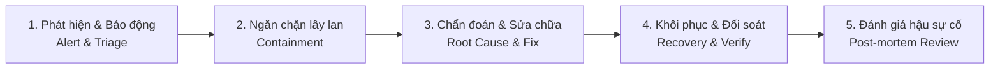

# QUY TRÌNH ỨNG CỨU SỰ CỐ VẬN HÀNH & KẾ HOẠCH ROLLBACK (INCIDENT RESPONSE SOP)
**Dự án:** LMS EdTech Platform — Hệ thống Quản trị Học tập K12  
**Đối tượng:** Đội ngũ Kỹ thuật Nền tảng, Quản trị SRE & Ban Chỉ đạo Pilot  
**Phạm vi:** Giai đoạn Thí điểm Trường THCS Nguyễn Du (Khối 6–9)  
**Phiên bản:** 1.0 (Phase 8 Pilot)  

---

## 1. MA TRẬN PHÂN LOẠI CẤP ĐỘ SỰ CỐ (INCIDENT SEVERITY MATRIX)

| Mức độ | Định nghĩa sự cố | Ví dụ cụ thể | Cam kết phản hồi (SLA) | Mục tiêu khắc phục (RTO) |
|:---:|---|---|:---:|:---:|
| **P1 - Blocker / Critical** | Toàn bộ hệ thống không thể truy cập; Mất mát dữ liệu bài nộp/điểm số; Lộ lọt dữ liệu chéo trường/lớp. | Học sinh nộp bài bị lỗi 500 hàng loạt; Học sinh trường A xem được bài trường B; Cơ sở dữ liệu ngừng phản hồi. | **$\le$ 15 phút** | **$\le$ 2 giờ** (RPO $\le$ 15m) |
| **P2 - Major** | Một tính năng cốt lõi bị lỗi nhưng có phương án thay thế; Độ trễ hệ thống vượt quá 2 lần SLA (p95 > 6s). | Không tải được danh sách điểm danh; Chức năng nộp bài tự luận bị treo tải ảnh; RPC báo cáo quá thời gian chờ. | **$\le$ 30 phút** | **$\le$ 4 giờ** |
| **P3 - Minor** | Sự cố dịch vụ phụ trợ, không ảnh hưởng đến việc dạy, học, nộp và chấm bài của giáo viên. | Dịch vụ AI trả lời chậm hoặc lỗi 429 Quota; Hàng đợi email thông báo bị chậm 10 phút. | **$\le$ 2 giờ** | **$\le$ 12 giờ** |
| **P4 - Low** | Lỗi hiển thị giao diện nhỏ, sai lỗi chính tả, không ảnh hưởng nghiệp vụ. | Lệch khoảng cách nút bấm trên màn hình nhỏ; Căn lề báo cáo chưa đẹp. | **$\le$ 24 giờ** | Bản vá tiếp theo |

---

## 2. QUY TRÌNH 5 BƯỚC PHẢN ỨNG SỰ CỐ KHẨN CẤP (5-STEP INCIDENT RESPONSE)



### Bước 1: Tiếp nhận thông tin & Kích hoạt Báo động (Alert & Triage)
- Nguồn phát hiện: Cảnh báo tự động từ monitoring script `daily_pilot_health_monitor.js` hoặc phản ánh từ Giáo vụ trường.
- Kỹ sư trực ban xác định cấp độ sự cố (P1/P2/P3/P4).
- Nếu sự cố là P1: Lập tức kích hoạt kênh khẩn cấp (War Room) và thông báo cho Ban Giám hiệu nhà trường.

### Bước 2: Ngăn chặn tác động tiêu cực (Containment)
- **Nếu sự cố do AI:** Kích hoạt Kill-switch ngay lập tức:
  ```sql
  UPDATE public.schools SET ai_enabled = false WHERE id = '<school_id>';
  ```
- **Nếu sự cố rò rỉ phân quyền:** Tạm dừng các Server Actions liên quan hoặc thu hồi quyền truy cập API của role bị ảnh hưởng qua middleware.
- **Nếu sự cố nghẽn mạng lúc nộp bài:** Thông báo cho giáo viên gia hạn thời gian nộp bài thêm 30 phút; hướng dẫn học sinh không bấm nộp liên tục (cơ chế Idempotency sẽ bảo vệ khi đường truyền hồi phục).

### Bước 3: Chẩn đoán nguyên nhân gốc rễ & Sửa chữa (Diagnosis & Resolution)
- Kiểm tra log máy chủ và nhật ký giao dịch `audit_events` và `outbox_events`.
- Kiểm tra trạng thái kết nối cơ sở dữ liệu Supabase connection pooling.
- Triển khai bản vá (hotfix) trên nhánh cách ly, chạy trọn bộ kiểm thử `npm run test` trước khi merge vào nhánh production.

### Bước 4: Khôi phục dịch vụ & Đối soát dữ liệu (Recovery & Verification)
- Sau khi triển khai bản vá, chạy script đối soát dữ liệu:
  ```bash
  node scripts/pilot/dry_run_phase8_pilot.js
  ```
- Xác nhận các chỉ tiêu: Số bài nộp khớp 100%, không có dữ liệu trùng, p95 quay về mức $\le$ 3.0s.

### Bước 5: Biên bản đánh giá hậu sự cố (Post-Mortem & Preventive Action)
- Trong vòng 24 giờ sau khi giải quyết sự cố P1/P2:
  - Lập biên bản Post-Mortem: Nguyên nhân gốc rễ, dòng thời gian xử lý, thiệt hại dữ liệu (nếu có).
  - Bổ sung kịch bản kiểm thử tự động mới vào thư mục `tests/` để ngăn chặn lỗi lặp lại.

---

## 3. KẾ HOẠCH DỰ PHÒNG & QUAY LẠI (ROLLBACK PLAN)

### 3.1. Rollback Phiên bản Ứng dụng (Application Code Rollback)
- Mọi bản release lên hệ thống đều được đánh thẻ Git Tag chuẩn (ví dụ: `v1.8.0-pilot`).
- Khi phát hiện bản cập nhật mới gây lỗi nghiêm trọng:
  ```bash
  git checkout tags/v1.7.0-stable
  npm run build
  # Khởi động lại dịch vụ qua trình quản lý tiến trình
  ```

### 3.2. Khôi phục Cơ sở Dữ liệu theo thời điểm (Database PITR Recovery)
- Hệ thống cơ sở dữ liệu Supabase PostgreSQL đã kích hoạt cơ chế sao lưu liên tục (Continuous WAL Archiving).
- Chỉ tiêu cam kết:
  - **RPO (Recovery Point Objective):** $\le$ **15 phút**.
  - **RTO (Recovery Time Objective):** $\le$ **2 giờ** (Đã diễn tập đạt ~1 phút).
- Khi có sự cố phá hủy cấu trúc dữ liệu hoặc lỗi con người nghiêm trọng:
  1. Dừng ghi dữ liệu trên ứng dụng (Chuyển sang chế độ bảo trì `maintenance mode`).
  2. Truy cập bảng điều khiển Supabase $\rightarrow$ Chọn điểm thời gian phục hồi ngay trước khi sự cố xảy ra (ví dụ: `T - 15 phút`).
  3. Khôi phục instance và thực hiện đối soát:
     ```bash
     node scripts/tests/dr_rehearsal_simulation.js
     ```
  4. Mở lại dịch vụ cho giáo viên và học sinh.
