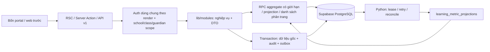

# Rà soát và kế hoạch tối ưu toàn bộ LMS — 04/11/2026

> Cập nhật sau yêu cầu xóa dữ liệu: các số đo/metadata trong bản rà soát dưới đây là baseline **trước khi dựng lại**. Project LMS đã được rebuild và có bộ dữ liệu giả mới 200 học sinh/15 giáo viên/1 quản trị; xem [biên bản và bước Vercel còn lại](DUNG_LAI_DATABASE_MOT_TRUONG_2026-11-04.md). Không dùng kết luận “chưa có RPC/projection” bên dưới làm trạng thái database hiện tại.

## Kết luận và phạm vi

Ưu tiên đồng bộ phiên bản code/database và giảm số lượt truy vấn phụ thuộc trước khi mở rộng tính năng. Giữ Next.js/TypeScript, Supabase PostgreSQL/Auth/Storage và Python worker đã có; chuyển từng module sang service/read model có phạm vi trường. Chưa có bằng chứng cần thay nhà cung cấp DB, thêm Redis, tách microservice hoặc viết lại toàn bộ dữ liệu từ đầu.

Áp dụng cho admin, giáo viên, học sinh và phụ huynh. Phạm vi sản phẩm hiện hành theo [bản triển khai 03/11](REBUILD_K12_IMPLEMENTATION.md): THPT 100–300 học sinh, ưu tiên lớp 12/Toán–Văn–Anh, web trước app, một người phát triển có AI hỗ trợ. Các mốc THCS/2–4 người/22–26 tuần trong kế hoạch tháng 9 là giả định lịch sử, cần ước lượng lại theo backlog thực tế.

Nguồn đối chiếu: mã nguồn, migration trong repo, danh sách bảng/cột và RLS do người dùng cung cấp trong chat ngày 04/11, cùng kết nối Supabase API chỉ đọc. Bản người dùng cung cấp có cấu trúc/policy nhưng không có toàn bộ index, function body, trigger hay thống kê truy vấn; không coi đó là DDL có thể chạy để thay thế database.

## Bằng chứng trên kết nối hiện tại

Đã thực hiện GET OpenAPI và 24 HEAD request giới hạn `id`, `limit=1`; không trả nội dung hàng, không gọi RPC, không ghi database. Mỗi bảng có 3 lần đo không count và 1 lần lấy count ước tính theo planner. Kết quả cục bộ không đưa vào Git:

- `.local/live-schema-inventory.json`, thời điểm `2026-11-04T00:41:03Z`.
- `.local/live-performance-audit.json`, thời điểm `2026-11-04T00:43:14Z`.

Metadata có **95 resource definition và 15 RPC**. Resource có thể gồm view, vì vậy không gọi đây là 95 bảng. Không xác nhận môi trường này là production khi chưa có thông tin triển khai.

| Đường đọc nhỏ | Thời gian 3 lần HEAD (ms) | Số hàng ước tính bởi planner |
|---|---|---:|
| classes | 195 / 666 / 776 | 6 |
| enrollments | 510 / 416 / 334 | 54 |
| attendance_records | 379 / 409 / 300 | 272 |
| exam_submissions | 325 / 277 / 345 | 34 |
| homework_submissions | 338 / 425 / 391 | 25 |
| student_activity_logs | 261 / 319 / 294 | 817 |

Tất cả 18 HEAD không count trả 200; 6 HEAD count trả 206. GET metadata mất 1.960 ms trong lần audit này. Đây là quan sát từ máy phát triển qua network/TLS/gateway tới DB, **không phải thời gian SQL, p95 dashboard hay phép đo RLS**; service role bỏ qua RLS. Count là ước tính và có thể cũ. Không dùng các số này để khẳng định database lớn hoặc thiếu CPU.

**Lệch hợp đồng code–DB đã quan sát qua API:**

- Chưa thấy `learning_metric_projections`.
- Chưa thấy 8 RPC mà source nâng cấp cần: `get_student_today`, `get_teaching_classes`, `learning_activity_summary_scoped`, `set_school_grade`, `begin_school_exam`, `submit_school_homework`, `enroll_school_student`, `reorder_school_content`.
- `exam_submissions` chưa có `revision`; `homework_submissions` chưa có `revision`, `total_points`, `questions_snapshot`; `outbox_events` chưa có `schema_version`, `claim_token`, `locked_until`.
- `courses.teacher_id` chưa có trong metadata; migration `202611030001` mới bổ sung cột này.

Vắng mặt trong metadata nghĩa là chưa được expose cho role/schema cache đang kiểm tra, chưa chứng minh lịch sử migration hoặc catalog đầy đủ. Với hợp đồng này, không thể rollout các màn mới rồi giả định mọi tính năng sẽ hoạt động. Phải kiểm tra catalog trên staging, nâng cấp và kiểm tra lại API trước khi chuyển traffic.

## Findings theo mức ưu tiên

| Mức | Bằng chứng | Hệ quả | Hướng xử lý |
|---|---|---|---|
| P0 | Các RPC/cột/projection ở trên có trong source nhưng chưa thấy trên API thật | Trang học sinh mới và analytics có thể trả lỗi/không có dữ liệu; tăng tốc UI không sửa được hợp đồng thiếu | Kiểm kê catalog, rehearsal bốn migration 03/11 trên bản sao, đối soát và release code/schema cùng phiên bản |
| P0 | RLS do người dùng cung cấp có `ALL ... USING true WITH CHECK true` ở rooms, class_schedules, discussion_messages, progress, quiz_attempts, item_contents, quiz_questions; một số bảng goals/habits ghi role `public` dù tên policy là “Service role” | Nếu grant và RLS hiện hành đúng bản này, browser có thể thao tác vượt phạm vi; tên policy không quyết định quyền | Kiểm tra ACL/catalog; chuyển đường ghi legacy về guarded service, thay bộ policy trong transaction; test âm/dương trước rollout |
| P0 | Nhiều policy lấy admin từ `auth.jwt()->user_metadata`; nhiều bản sao policy cùng command | Quyền từ metadata có thể bị người dùng sửa; các policy permissive kết hợp bằng OR nên thêm policy chặt không vô hiệu policy rộng | Dùng membership đã xác minh; liệt kê/xóa đúng policy cũ khi thay; không tắt RLS để tăng tốc |
| P1 | `admin/page.tsx` chờ 3 count và 6 nguồn báo cáo trong một Promise.all trước khi trả phần chính; mặc định range=all | Một nguồn chậm giữ toàn bộ trang; tải lịch sử không giới hạn | Tách summary, chuyên cần, điểm, tiến độ thành Suspense độc lập; aggregate có trường/kỳ/ngày; drill-down phân trang |
| P1 | `admin/analytics-actions.ts` đọc toàn bộ enrollments/homework/submissions và tính nhóm tại Node; daily active phân trang Auth listUsers | Fan-out lớn, payload dư; báo cáo có thể bị cắt ở giới hạn PostgREST | RPC có quyền và projection từ dữ liệu gốc; last_seen/activity summary thay quét Auth; không đổi nghĩa chỉ số âm thầm |
| P1 | `teacher/actions.ts` đọc classes → assignments/exams → scores; `progress-actions.ts` tải mọi bài/bài nộp rồi slice 10 | Ba đợt phụ thuộc, lặp dữ liệu giữa widget; thống kê chưa tính đủ homework và không dùng phân công mới | Một read model summary theo lớp được phép, thêm danh sách ưu tiên có giới hạn tại SQL; thống nhất nguồn bài tập |
| P1 | `parentStudent.ts:fetchParentDashboardData` có nhiều await nối tiếp, all-time attendance, ba nguồn điểm; client chờ dashboard xong mới tải feedback | Nhiều round-trip và data waterfall; không có snapshot nhỏ cho lần hiển thị đầu | Guard quan hệ giám hộ có trường/hiệu lực; query độc lập song song có giới hạn; summary server-render + phần chi tiết tải theo tab |
| P1 | Guard `canParentViewStudent` chỉ kiểm cặp parent/student; parent page đọc links không lọc xác minh/trường/hiệu lực; query điểm legacy không lọc published/locked | Phạm vi và tính công bố chưa đồng nhất giữa màn cũ/mới | Dùng cùng parent scope/DTO và công thức điểm published, kiểm tra chéo trường/quan hệ hết hạn |
| P2 | getActorContext và getCurrentUserProfile/page xác thực riêng dù React cache đã có | Request Auth dư trong đường dùng chung cả bốn portal | Dùng chung getCurrentUser theo render; giữ bearer token tách biệt và không cache session giữa request |
| P2 | Nhiều policy `auth.uid()`/role helper lặp lại và thiếu dữ liệu index thực | Có thể tốn kiểm tra từng hàng; chưa xác định mức ảnh hưởng | EXPLAIN theo đúng role, hợp nhất policy; cân nhắc `(select auth.uid())` với giá trị độc lập hàng; xác minh index trước khi thêm |

Hai finding RLS dựa trên **snapshot người dùng gửi**, chưa được API inventory xác thực lại từ `pg_policies`. Phải báo riêng mức tin cậy này. Migration `202611030003` chỉ xử lý một phần bảng; không được coi đó là đã đóng mọi policy legacy nêu trên.

## Thiết kế dữ liệu sau nâng cấp

| Nhóm | Nguồn chuẩn | Cách chuyển |
|---|---|---|
| Định danh/quyền | users/Auth cho danh tính; school_memberships và phân công cho quyền; identifiers cho mã trường/học sinh | users.role giữ tương thích; không lấy metadata làm quyền; profiles chỉ dữ liệu hồ sơ |
| Học vụ | schools → academic_years → terms; homerooms là lớp hành chính, classes là lớp môn, courses là nội dung dùng lại | Không suy khối từ courses.name; kiểm tra FK cùng trường trước khi siết NOT NULL |
| Bài giao/bài nộp | homework/homework_submissions và exams/exam_attempts/exam_submissions | assignments/questions/submissions là legacy; cần adapter/mapping source-id để chuyển, đối soát điểm và không đếm hai lần |
| Học liệu | course_items/item_contents và version/snapshot | lessons/class_sections/quiz_questions/quiz_attempts phải có mapping và kiểm kê nơi dùng trước khi nghỉ ghi |
| Chuyên cần | class_sessions cho lịch/buổi; attendance_sessions + attendance_records cho ghi nhận | attendance cũ và leave_requests được giữ lịch sử; chuẩn hóa sang absence_requests khi đối soát đủ. Không tự gộp hai loại session chỉ vì cùng ngày |
| Điểm/báo cáo | Bài nộp và trạng thái công bố là nguồn; projection có rules_version/computed_at | student_class_stats, behavior scores, learning_metric_projections là số suy ra; xác định metric owner và tránh ba nơi cùng làm nguồn chuẩn |
| Sự kiện | outbox_events, idempotency_keys, audit_events | Dùng queue đã có; worker projection tách khỏi response ghi; notification_deliveries cần consumer thật |
| AI/telemetry | learning_ai_jobs và dữ liệu sự kiện đã giới hạn | Không gọi AI ở critical path tải dashboard/nộp bài; không dùng JSON phân tích lớn cho danh sách |
| Tài chính legacy | fee_plans/invoices/payments/fee_schedules | Bảo toàn dữ liệu, tách khỏi đường đọc LMS chính theo phạm vi sản phẩm hiện tại |

Các `school_id` nullable, `exam_id`/`student_id` nullable và JSON attempt_history cần đối soát trước khi siết constraint/tách lịch sử thành hàng. Không `DROP`/đổi kiểu hàng loạt, gộp user theo email hoặc ép mọi hàng về một trường để làm sạch schema. Danh sách cột người dùng gửi không chứng minh thiếu unique/FK/index vì không liệt kê đầy đủ các constraint tổ hợp.

## Kiến trúc đọc và ghi thống nhất



- Student: hoàn tất rollout `get_student_today` hiện có, không viết thêm nguồn task song song.
- Teacher: summary theo school + các class đang được phân công; đếm/chấm pending ở DB, danh sách học sinh thiếu bài tải theo drill-down.
- Parent: summary theo school + con đã xác minh + khoảng ngày; chỉ published/locked, chọn con trước khi tải chi tiết; dữ liệu con cũ phải được bỏ khi đổi lựa chọn.
- Admin: summary nhỏ theo trường/kỳ; biểu đồ theo ngày lấy aggregate; danh sách theo cursor ổn định `(created_at,id)` hoặc trang có ordering rõ.
- React cache dùng cho dedup trong render. React Query key gồm user/school/role/filter; invalidation theo tài nguyên. Không cache toàn cục actor/token hoặc trả cache cũ sau logout/đổi trường.
- Realtime hiện đã debounce 250 ms và lọc school/user ở một số bảng. Không mô tả lại như chưa sửa; đo số invalidation thực, giảm phạm vi theo lớp khi chính sách cho phép.

## Thứ tự triển khai thay cho ưu tiên cũ

| Đợt | Công việc cụ thể | Gate chuyển bước |
|---|---|---|
| 0 — Baseline thực | Chụp catalog/index/ACL/RLS/trigger; trace bốn dashboard và các luồng danh sách/lịch/điểm danh/nộp bài; phân biệt dev compile với production request | Có số query, payload, server/network/render timing và phiên bản schema; có bản sao staging phục hồi được |
| 1 — Đồng bộ và quyền | Rehearse migration 03/11, sửa khác biệt schema thật; rà soát policy rộng/metadata; typed client từ staging | RPC/cột/projection hợp đồng có đủ; test user/chéo trường/chấm điểm/giám hộ; đối soát dữ liệu đạt |
| 2 — Đường dùng chung | Auth dedup, profile/context nhỏ; guarded service làm điểm truy cập dữ liệu; bỏ đọc dữ liệu nhạy cảm trực tiếp từ browser khi thiếu DTO | Không tăng query xác thực theo số widget; bearer/cookie/activation giữ đúng hành vi |
| 3 — Bốn dashboard | Admin aggregates + Suspense; teacher summary; student RPC hiện có; parent summary + tabs và feedback độc lập | Kết quả khớp nguồn, không truncate, không điểm nháp, có trạng thái lỗi; số round-trip giảm theo trace |
| 4 — Toàn bộ màn dữ liệu | User/classes/students/search phân trang; lịch theo tuần/tháng; bài học tải mục cần xem; attendance batch; thông báo theo cursor | Không query all-time mặc định cho danh sách; kiểm tra >1.000 bản ghi; không N+1 theo học sinh |
| 5 — Index/worker | Chọn index từ EXPLAIN; tối ưu view facts/worker reconcile theo lớp bẩn nếu trace cho thấy quét toàn bộ; kiểm tra outbox backlog | Query dùng index có ích, không duplicate/unused đáng kể; retry không lặp điểm/bài; projection có độ trễ đo được |
| 6 — Phát hành | Chạy E2E, tải giả lập, restore/rollback, mở từng nhóm portal/lớp | Đạt các chỉ số bên dưới trên staging tương đương; chốt code/schema/worker cùng đợt |

Không hoãn hiệu năng tới Phase 7. Không chốt thời gian toàn bộ trước khi có trace và diễn tập nâng cấp; hoàn thành code không đồng nghĩa đã deploy/nghiệm thu.

## Bộ công cụ và SQL đã chuẩn bị

```sh
npm run db:inventory
npm run db:performance
npm run db:schema:candidate
```

`scripts/db/performance-audit.mjs` chỉ GET metadata và HEAD; có timeout, không in credentials/project URL/nội dung hàng. Báo cáo nằm trong `.local/`. Các probe service-role chỉ là baseline mạng/API, không đo policy theo tài khoản thực.

`scripts/db/performance-catalog.sql` là SQL chỉ đọc, đặt timeout, lấy index/RLS/trigger/FK/kích thước/statistics; chạy bằng PostgreSQL login chỉ đọc. Chưa chạy script này lên DB thật vì workspace chưa có DSN quản trị/chỉ đọc phù hợp.

`supabase/proposals/20261104_performance_indexes.sql` là **8 index ứng viên cho local/staging**, không nằm trong migration chain. Có truy vấn đích trong comment. Phải đối chiếu index tương đương trong catalog và EXPLAIN; `IF NOT EXISTS` chỉ tránh trùng tên. Chưa có bằng chứng tất cả 8 index đều cần trên DB thật. Khi đủ bằng chứng, tạo migration production riêng với chiến lược CONCURRENTLY ngoài transaction và kiểm tra index invalid sau lỗi.

`npm run db:schema:candidate` sinh `.local/lms-k12-schema-candidate.sql`: gộp 19 migration của canonical bootstrap (có sửa lỗi fresh-install đã được repo định nghĩa) và 8 index ứng viên thành một tệp để đọc/thử dựng Supabase local rỗng. Không kết nối database khi sinh file. Đây **không phải SQL nâng cấp database đang có dữ liệu**, chưa hoàn tất audit mọi policy legacy và chưa phải bản production đã nghiệm thu; dùng kế hoạch ở trên để chuyển từng module trước khi rollout.

Không tạo function chạy SQL tùy ý qua service role, không bật explain công khai để phục vụ kiểm kê. [Supabase hướng dẫn kiểm tra query plan](https://supabase.com/docs/guides/api/query-plans) và nêu rõ EXPLAIN ANALYZE thực thi câu lệnh; chỉ dùng trên SELECT đã kiểm tra và có giới hạn ở staging.

## Thay đổi source trong lần rà soát này

- Sửa import CommonJS của `@next/env` để script inventory chạy được trên Node 24.
- `getActorContext` dùng cùng `getCurrentUser` với layout/profile/page; lookup bearer có cache key riêng, lỗi Auth trả null. Không bỏ xác thực tại proxy hay guard.
- Parent page dùng helper xác thực chung. Các query nghiệp vụ parent legacy chưa được viết lại trong bản thay đổi này.
- Thêm probe chỉ đọc, SQL catalog và SQL index ứng viên; cập nhật tài liệu và điểm vào npm.

Đây là bước nền để thực thi kế hoạch; chưa tuyên bố viết lại/tăng tốc xong toàn bộ hệ thống và chưa chạy migration thật.

## Tiêu chí kiểm chứng

- Mỗi luồng ít nhất 100 request sau warm-up trên cùng bộ dữ liệu/network; lưu p50/p95, số request DB/Auth, payload, lỗi và thời gian server/browser. Các probe 3 mẫu bên trên không thay thế benchmark này.
- Mục tiêu staging: dashboard mỗi vai trò p95 ≤3 giây; mở điểm danh ≤2 giây; lưu 40–50 bản ghi/nộp bài p95 ≤3 giây; 50 lượt nộp gần đồng thời không mất/trùng bài. Đây là mục tiêu, chưa đo đạt.
- Dữ liệu giả có lịch sử một năm và >1.000 bản ghi mỗi nguồn báo cáo quan trọng; so sánh aggregate với SQL nguồn, giữ điểm 0, lọc published/locked đúng quy tắc và không đếm hai lần legacy/canonical.
- RLS/ACL test với anon/authenticated/service_role, user_metadata giả, sai trường/lớp, membership tạm dừng, phân công/giám hộ hết hạn; kiểm tra policy OR và quyền EXECUTE trên SECURITY DEFINER.
- Kiểm tra phản hồi UI khi RPC/cột chưa cài, mất mạng, đổi con liên tiếp, đăng xuất/đổi trường; không giữ cache cá nhân cũ.
- Báo cáo kết quả chạy local của lần thay đổi này ghi ở phần cập nhật [TEST_PLAN](TEST_PLAN.md); không dùng kết quả unit/PGlite để nhận là đã benchmark Supabase thật.
